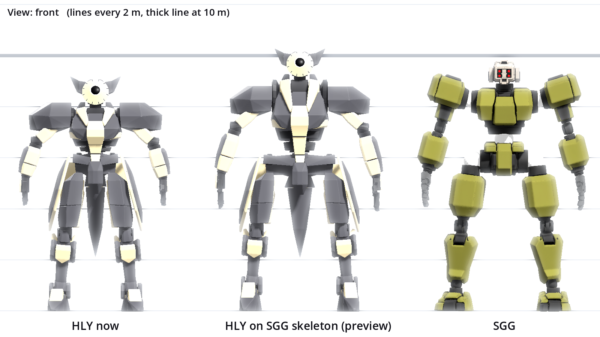
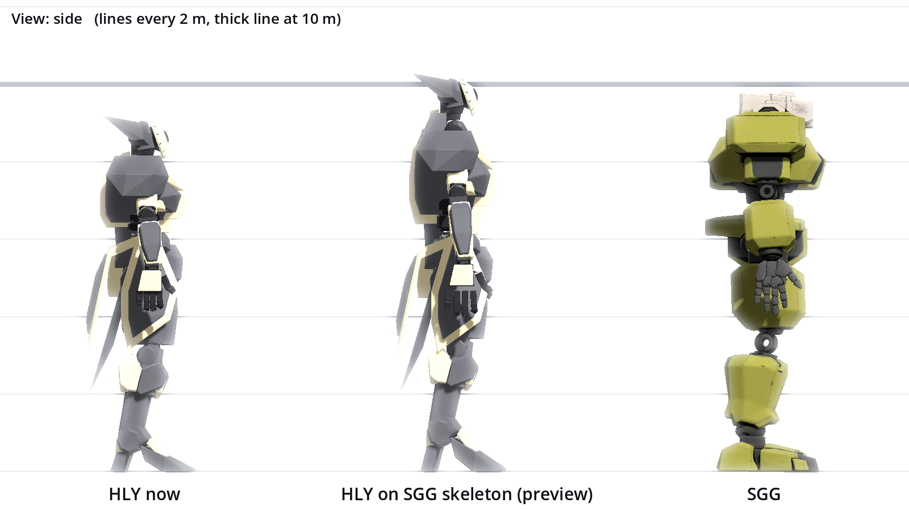
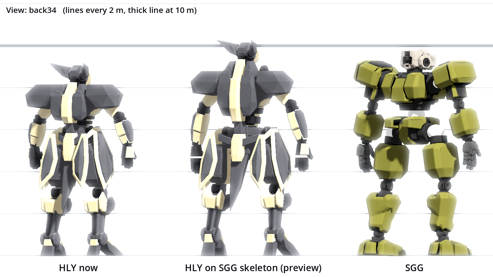
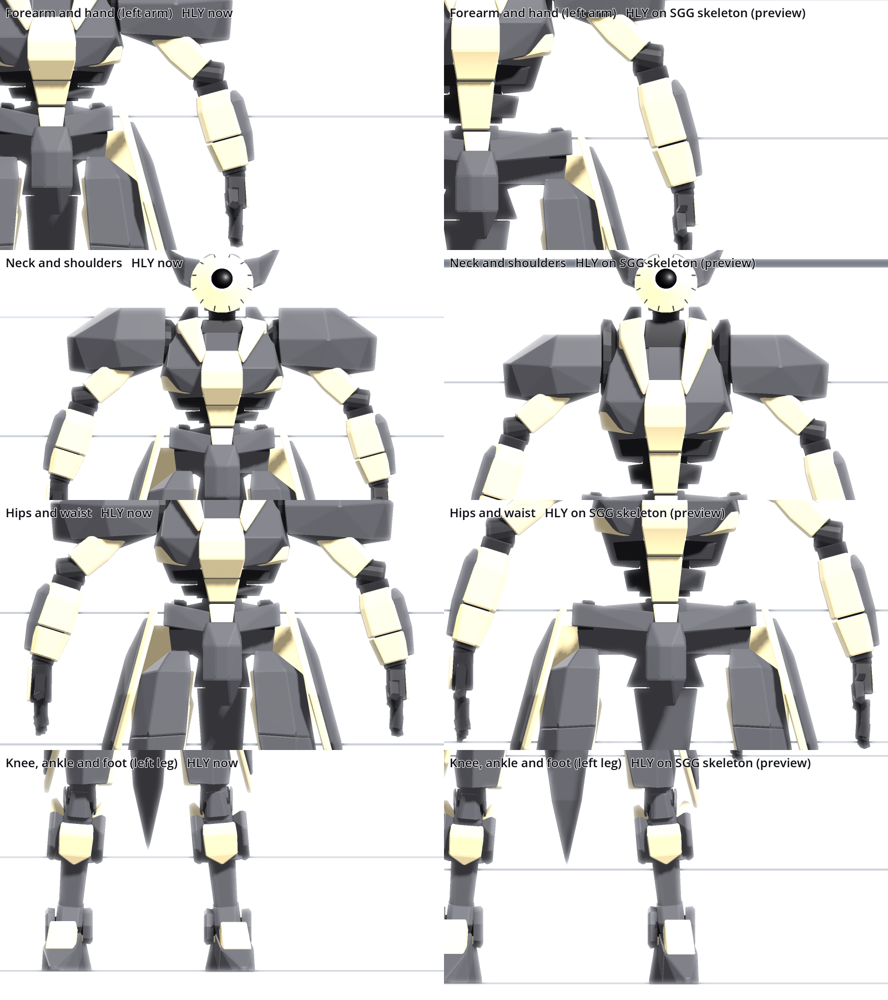

# HLY-101 on the SGG-101 skeleton: preview (2026-11-08)

User request: "Let's align skeleton with SGG's. Mech weight will now depend how thick the 'muscles' or parts are. Adjust HLY as necessary. Show me before and after and seek confirmation."

This is a preview. No game data changed. Tools: `tools/godot/preview_refit_parts.gd` (refit and pictures), `tools/godot/measure_part_volumes.gd` (volumes and weights).

## Pictures

Left to right: HLY now, HLY on the SGG skeleton (preview), SGG. Same ground, same orthographic camera, lines every 2 m (thick at 10 m). The materials are the ones inside the part files.

- Front: `docs/hly_refit_preview_front.png`
- Side: `docs/hly_refit_preview_side.png`
- 3/4 back: `docs/hly_refit_preview_back34.png`
- Close-ups (left column HLY now, right column refit): forearm and hand, neck and shoulders, hips and waist, knee and foot: `docs/hly_refit_preview_closeup.png`

## What the refit does

Every Haliya vertex is moved from its HLY bone to the same bone on the SGG rig (weights as in the file; almost every mesh is 100% on one bone). Pieces keep their thickness. Only the length between joints changes, by a piecewise stretch along the axis with slope 1 outside the stretched span, so a piece beyond a joint is carried and not stretched.

| Chain | Rule | Stretch |
|---|---|---|
| Upper arm | along its axis, elbow lands on SGG elbow | 1.07 |
| Forearm | along its axis, wrist lands on SGG wrist | 1.37 (1.98 / 1.45) |
| Hand, fingers | place only, keep size | 1.00 |
| Thigh | along its axis | 0.92 |
| Shin | along its axis | 0.96 |
| Foot | the part below the ankle, vertical, sole stays on the ground | 1.31 (ankle 1.05 / 0.80) |
| Pelvis | place; the width spreads outside the middle block (half width 0.30 m) to the SGG hip joint | x 2.3 to 2.5 on the hip belts and shells |
| Torso, waist zone (torso Y -0.15 to +0.25) | stretches to meet the pelvis (SGG pelvis to torso is 0.43 m longer) | 2.1 |
| Torso, chest (Y 0.25 to 1.24) | stretches up to the SGG shoulder joint | 1.25 |
| Torso, neck zone (Y 1.24 to 1.59) | stretches up to the SGG head joint | 2.3 |
| Torso, sides | the shoulder width spreads outside half the shoulder distance | 1.2 |
| Head | place only | 1.00 |
| Pauldrons (sleeve bones), skirts | follow the shoulder joint and the hip joint (place only) | 1.00 |

Joint landing check (script output): hip, knee, ankle, elbow, wrist land within 0.01 m of the SGG joints. Torso on pelvis is 0.44 m on purpose (the waist stretch closes it). Head and shoulders differ 0.1 to 0.17 m in Z, because the SGG torso bone sits 0.12 m forward and the refit takes the torso place from the shoulder joints.

## Numbers

Heights are rest-pose joint heights (m). "HLY refit" has the SGG joints by construction.

| | HLY now | HLY refit | SGG |
|---|---|---|---|
| Head joint height | 7.95 | 9.04 | 9.04 |
| Shoulder joint height | 7.60 | 8.24 | 8.24 |
| Pelvis height | 6.14 | 6.10 | 6.10 |
| Hip width (thigh to thigh) | 1.37 | 2.40 | 2.40 |
| Leg, hip to ankle | 5.24 | 4.93 | 4.93 |
| Ankle height | 0.80 | 1.05 | 1.05 |
| Pelvis to torso | 0.23 | 0.66 | 0.66 |
| Torso to head | 1.59 | 2.30 | 2.30 |
| Shoulder width | 2.43 | 2.70 | 2.70 |
| Upper arm | 1.45 | 1.55 | 1.55 |
| Forearm | 1.45 | 1.98 | 1.98 |
| Hand to grip | 0.63 | 0.80 (bone only, hand mesh keeps size) | 0.80 |

Mesh size of the whole mech at rest (width, height, depth, m): HLY now 5.94 x 9.21 x 2.82, HLY refit 6.60 x 10.30 x 2.82, SGG 6.72 x 9.85 x 3.13. The Haliya head (horns) reaches 1.3 m above its joint (SGG 0.8 m), so the refit Haliya is 0.45 m taller than SGG.

## Weight from thickness

Rule: part weight = density x volume, one density per part type (head, core, arm, legs), fitted so the SGG weights in `data/parts` stay (arms: the pair together, so the left and right arm come out 5.02 and 4.98 t).

Volume method (`measure_part_volumes.gd`): per mesh surface, vertices welded, closed surfaces by signed tetrahedra (exact). Open surfaces (SGG core, arms, legs: 9 of 27 surfaces, which carry 8.0 of 8.3 m3 of the core) by a voxel fill (0.05 m, majority of the three axis rays); a signed volume about the box centre agrees within 1% on them (8.00/8.00 core, 3.35/3.35 arm, 6.19/6.16 legs). The Haliya parts are many separate pieces that overlap each other (plates over shells), the SGG parts are merged blobs. So two volumes are given: the plain sum of the pieces, and the voxel union where an overlap counts once. The union is the fairer mass. Both come from the same script run.

### A. Union volume (recommended)

Densities (t/m3): head 3.125, core 2.167, arm 1.019, legs 0.952.

| Part | Current t | Volume m3 | Proposed t | Refit volume m3 | Proposed t after refit |
|---|---|---|---|---|---|
| SGG head | 4.00 | 1.28 | 4.00 | | |
| SGG core | 18.00 | 8.31 | 18.00 | | |
| SGG arm L | 5.00 | 4.93 | 5.02 | | |
| SGG arm R | 5.00 | 4.89 | 4.98 | | |
| SGG legs | 16.00 | 16.81 | 16.00 | | |
| SGG total | 48.00 | | 48.00 | | |
| HLY head | 2.50 | 0.68 | 2.12 | 0.68 | 2.12 |
| HLY core | 14.00 | 4.80 | 10.40 | 7.74 | 16.76 |
| HLY arm L | 4.00 | 2.70 | 2.76 | 2.89 | 2.95 |
| HLY arm R | 4.00 | 2.70 | 2.75 | 2.84 | 2.89 |
| HLY legs | 13.00 | 11.54 | 10.98 | 12.11 | 11.52 |
| HLY total | 37.50 | | 29.01 | | 36.24 |

### B. Sum of piece volumes (overlaps counted twice)

Densities (t/m3): head 3.084, core 2.177, arm 1.019, legs 0.947.

| Part | Current t | Volume m3 | Proposed t | Refit volume m3 | Proposed t after refit |
|---|---|---|---|---|---|
| SGG head | 4.00 | 1.30 | 4.00 | | |
| SGG core | 18.00 | 8.27 | 18.00 | | |
| SGG arm L | 5.00 | 4.93 | 5.02 | | |
| SGG arm R | 5.00 | 4.89 | 4.98 | | |
| SGG legs | 16.00 | 16.90 | 16.00 | | |
| SGG total | 48.00 | | 48.00 | | |
| HLY head | 2.50 | 0.81 | 2.49 | 0.81 | 2.49 |
| HLY core | 14.00 | 5.76 | 12.54 | 9.35 | 20.36 |
| HLY arm L | 4.00 | 3.44 | 3.51 | 3.73 | 3.80 |
| HLY arm R | 4.00 | 3.44 | 3.51 | 3.69 | 3.76 |
| HLY legs | 13.00 | 13.59 | 12.86 | 14.10 | 13.35 |
| HLY total | 37.50 | | 34.90 | | 43.77 |

Totals are head, core, two arms and legs. SGG booster and generator (3 t each) are not part types here.

What the numbers say:

- Now, Haliya weighs 37.5 t in the data and 29 to 35 t by volume. The head, arms and legs are close to the current numbers in method B. Core is 14 t in the data and 10 to 12.5 t by volume.
- After the refit, Haliya gets heavier: 36 to 44 t, against 48 t for SGG. The core grows most (+61% in volume, 10.4 to 16.8 t in A). The SGG torso is taller (shoulders 0.26 m higher, head 0.45 m higher above the shoulders, waist 0.43 m longer), and the stretch adds that height to the chest shells (+55% each), center block and back blocks. In method B the refit Haliya (43.8 t) comes close to SGG (48 t), so a "light" mech would not be much lighter. This is the main thing to decide (see questions).
- Legs and arms change little (+5% and +7%).

## Visual findings (honest)

No part is exploded or collapsed, and no gap opens at a joint. What changes and what to look at:

1. Chest and shoulders look bulkier and taller than today (25% taller, sides 20% wider). The chest shells, back blocks and spine plate get tall. The tan collar blades and the neck arcs become tall because the neck zone stretches 2.3 times; the head's own neck piece is not stretched, so it shows as a dark neck column between the collars.
2. The waist: the dark rib bands and the waist joint stretch 2.1 times, so the ribs look spaced out. A new connector piece or a taller pelvis block would look better than a stretch.
3. Forearms are 37% longer with the same thickness and the same hand, so the hand looks small on the forearm. The tan forearm blocks look long.
4. Hips: the pelvis belts and hip shells widen 2.3 to 2.5 times and read as a flat wide bar across the hips. The thighs and the skirt plates move out 0.5 m with the joints and keep their size. The center blade on the pelvis (`Skirt_back_tip`) keeps its length.
5. Feet are 31% taller below the ankle (the SGG ankle is 0.25 m higher); the foot shape is taller.
6. Shin and thigh pieces change by 4 to 8% only.
7. Fingers keep their size but sit on the SGG finger joints, which are about 30% further apart; no gap is visible in the pictures at this size.

## What the full change needs

1. Blender: rebuild `haliya_rig.glb` on the SGG offsets (same 64 bones, parents and rest rotations; only offsets change), through `tools/blender/haliya_rig_light.py` and `export_mech_parts.py` on `haliya.blend`. Move the part meshes onto the new joints as in this preview or remodel the stretched pieces (torso, waist, neck, hips) by hand.
2. Rebuild the parts `haliya_{head,core,arm_l,arm_r,legs}.glb` on the new rig, with the part offsets (`PartData` and rig offsets read by `SkeletalPartModels`) now equal to SGG's.
3. Re-bake the Haliya clips (all of them: IK, arm carry, pelvis lift, walk lean, skirt follow) on the new rig, or use the SGG clip set directly, because the lengths now equal SGG's. Then the Haliya clip file may be the SGG one.
4. Update `PartData` weights in `data/parts/haliya/*.tres` from the chosen rule (A or B), and write the density per type as data (a `.tres`), so a new mech gets its weight from its volume.
5. Retune or remove what existed only because of the short rig: the pelvis lift table (`PELVIS_LIFTS`, 0.35 m in Walk), the walk lean (3 degrees), the arm carry turns (the A-pose arms already match SGG's), `back_pack_offset` of the core (7.25 y), the head and weapon mounts, the hand place (`ArmPart`), hitboxes and HP indicators that read the mesh, and the skirt follow values.
6. Check again: the knee and ankle poses at crouch and kneel, the two-hand weapon poses with the longer forearms, and the feet on the ground in every clip.

## Questions for the user

1. Weight method: A (overlaps once, Haliya about 36 t after the refit) or B (sum, about 44 t)?
2. Is a taller, bulkier Haliya torso right (core 10 t now by volume, 17 t after), or should the extra torso height become new pieces (waist and neck connectors) that keep the chest as it is today?
3. Is Haliya allowed to be 0.45 m taller than SGG (10.3 m against 9.85 m), because of its horns?
4. Foot height: stretch Haliya's feet 31% taller, or let the SGG ankle at 1.05 m hold a new shorter shin and a taller ankle block?
